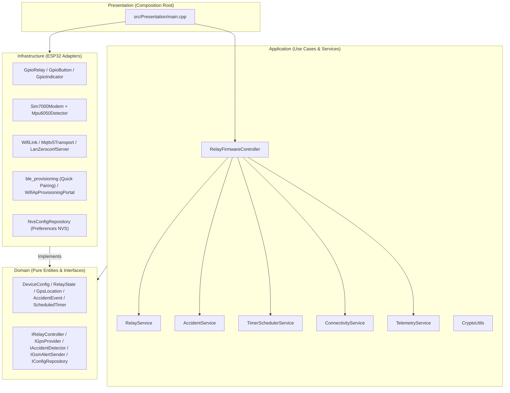
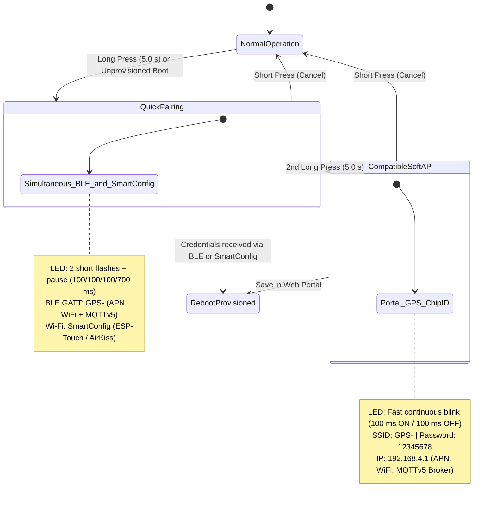

# GPS-Relay IoT ESP32 — Clean Architecture Firmware

**Smart ESP32 Relay Controller + GNSS/LTE Telemetry (SIM7000G) + Inertial Accident Detection (MPU6050) with Native MQTT 5.0 over TLS, Local LAN HTTP Control (`/zeroconf/*`), Quick Pairing (BLE GATT + SmartConfig), and Secure Chunked OTA**

[](https://www.espressif.com/en/products/socs/esp32)
[](https://en.cppreference.com/w/cpp/17)
[](https://mqtt.org)
[](https://github.com/h2zero/NimBLE-Arduino)
[](#system-architecture-clean-architecture)
[](https://platformio.org)
[](https://cmake.org)

---

## Table of Contents

- [Overview](#overview)
- [Key Features](#key-features)
- [Added Functions & Modules](#added-functions--modules)
- [System Architecture (Clean Architecture)](#system-architecture-clean-architecture)
- [Project Structure](#project-structure)
- [GPIO Pinout](#gpio-pinout)
- [2-Stage Pairing Workflow (Quick Pairing + SoftAP)](#2-stage-pairing-workflow-quick-pairing--softap)
- [Local LAN HTTP Control (`/zeroconf/*`) & mDNS](#local-lan-http-control-zeroconf--mdns)
- [MQTT 5.0 Communication Protocol](#mqtt-50-communication-protocol)
- [Accident Detection & Emergency SMS Alerts](#accident-detection--emergency-sms-alerts)
- [Status LED Indicator](#status-led-indicator)
- [Build & Host Unit Testing](#build--host-unit-testing)

---

## Overview

**GPS-ESP32** is an industrial-grade firmware for the **ESP32** microcontroller engineered in **Clean Architecture**. It integrates:
1. **Offline-First Relay Control** with immediate `< 20 ms` power-on state restoration (`StartupMode`: `Off`, `On`, `Stay`), `150 ms` deferred NVS writes, Inching / Pulse mode, and autonomous UTC scheduled timers.
2. **GNSS Satellite Telemetry & Cellular LTE-M / NB-IoT / GSM Connectivity** powered by the **SIM7000G** modem.
3. **Real-Time Impact, Rollover, and Harsh Driving Detection** via an **MPU6050** 6-axis IMU, with dual alert delivery over **MQTT 5.0** and **Emergency SMS**.
4. **2-Stage Hybrid Provisioning**: **Quick Pairing** (simultaneous **BLE GATT `GPS-<DeviceID>`** + **Wi-Fi SmartConfig `ESP-Touch / AirKiss`**) and a **Compatible SoftAP Captive Portal (`GPS-<ChipID>`)**.
5. **Local LAN HTTP Control** via port **`8081` (`/zeroconf/*`)** and **mDNS (`_ewelink._tcp`)** supporting plain JSON and `AES-128-CBC` (`MD5(deviceKey)`) encrypted payloads.

---

## Key Features

| Feature | Description |
|---|---|
| **Clean Architecture** | Strict 4-layer separation (`Domain`, `Application`, `Infrastructure`, `Presentation`) with zero hardware dependencies in `Domain` and `Application` |
| **Offline-First Relay Boot (`< 20 ms`)** | Restores the physical relay state from NVS immediately at boot (`initWithStartupConfig`) before initializing Wi-Fi, BLE, or MQTT |
| **Power-On State (`StartupMode`)** | Configurable power-on behavior (`Off`, `On`, `Stay`) with `150 ms` deferred NVS persistence (`flushDeferredSave`) to prevent Flash wear |
| **Inching / Pulse Mode** | Configurable auto-shutoff timer (`configurePulse`, `updatePulseTimer`) from `500 ms` to `36,000,000 ms` in `500 ms` steps |
| **Scheduled UTC Timers** | Up to `8` persistent NVS timers (`Once`, `Repeat`, `Duration`) evaluated once per second against UTC epoch time (`TimerSchedulerService`) |
| **Quick Pairing (BLE + SmartConfig)** | Simultaneous **BLE GATT (`GPS-<DeviceID>`)** and **ESP-Touch / AirKiss** provisioning triggered immediately upon holding the button for `5.0 s` |
| **Compatible SoftAP (`GPS-<ChipID>`)** | Stage 2 captive portal triggered by a 2nd `5.0 s` long press, preserving the `GPS-<ChipID>` SSID and `12345678` passphrase |
| **Local LAN HTTP & mDNS** | HTTP server on port `8081` (`/zeroconf/*`) + `_ewelink._tcp` mDNS discovery supporting plain JSON and `AES-128-CBC` encrypted payloads |
| **GNSS + LTE (SIM7000G) & MPU6050** | Satellite positioning, impact/rollover/harsh-dynamics detection, and redundant alerts via MQTT 5.0 and SMS |
| **Native MQTT 5.0 + Secure OTA** | Powered by `ESP32_MQTTv5` and `MQTTOTAv5` with non-blocking reconnection and `SHA-256` / `HMAC-SHA256` verification |

---

## Added Functions & Modules

### 1. Domain Layer (`src/Domain/`)
- `StartupMode`, `startupModeToString()`, `startupModeFromString()` ([`DeviceConfig.h`](file:///c:/Users/Jorge/Music/interruptor%20wifi/GPS-ESP32/src/Domain/Entities/DeviceConfig.h)): Power-on state modes (`Off`, `On`, `Stay`) and persistent fields `lastRelayState`, `pulseEnabled`, `pulseWidthMs`, `sledOnline`, alongside cellular `apn`, `apnUser`, and `apnPass`.
- `TimerType`, `ScheduledTimer` ([`ScheduledTimer.h`](file:///c:/Users/Jorge/Music/interruptor%20wifi/GPS-ESP32/src/Domain/Entities/ScheduledTimer.h)): Entity for local scheduled timers (`Once`, `Repeat`, `Duration`) with `startAction` and `endAction`.
- `IIndicator::setSledOnline()`, `IIndicator::isSledOnline()` ([`IIndicator.h`](file:///c:/Users/Jorge/Music/interruptor%20wifi/GPS-ESP32/src/Domain/Interfaces/IIndicator.h)): Non-blocking states `Disconnected`, `Connecting`, `QuickPairing`, `CompatibleAp`, `OtaProgress`, `Operational`, and `Error`.
- `IConfigRepository::saveLastRelayState()`, `saveStartupMode()`, `savePulseConfig()`, `saveSledOnline()`, `saveTimers()`, `loadTimers()` ([`IConfigRepository.h`](file:///c:/Users/Jorge/Music/interruptor%20wifi/GPS-ESP32/src/Domain/Interfaces/IConfigRepository.h)).
- `ITimeProvider::epochSeconds()` ([`ITimeProvider.h`](file:///c:/Users/Jorge/Music/interruptor%20wifi/GPS-ESP32/src/Domain/Interfaces/ITimeProvider.h)).

### 2. Application Layer (`src/Application/`)
- `RelayService` ([`RelayService.h`](file:///c:/Users/Jorge/Music/interruptor%20wifi/GPS-ESP32/src/Application/Services/RelayService.h), [`RelayService.cpp`](file:///c:/Users/Jorge/Music/interruptor%20wifi/GPS-ESP32/src/Application/Services/RelayService.cpp)):
  - `attachConfigRepository()`
  - `initWithStartupConfig()`
  - `flushDeferredSave()`
  - `hasPendingDeferredSave()`
  - `configurePulse()`
  - `updatePulseTimer()`
  - `isPulseEnabled()`, `getPulseWidthMs()`, `isPulseActive()`
  - `setStartupMode()`, `getStartupMode()`
  - `onRelayHardwareTransition()`
- `TimerSchedulerService` ([`TimerSchedulerService.h`](file:///c:/Users/Jorge/Music/interruptor%20wifi/GPS-ESP32/src/Application/Services/TimerSchedulerService.h), [`TimerSchedulerService.cpp`](file:///c:/Users/Jorge/Music/interruptor%20wifi/GPS-ESP32/src/Application/Services/TimerSchedulerService.cpp)):
  - `loadFromStorage()`
  - `saveToStorage()`
  - `upsertTimer()`
  - `clearAllTimers()`
  - `getActiveTimerCount()`
  - `evaluate()`
- `CryptoUtils` ([`CryptoUtils.h`](file:///c:/Users/Jorge/Music/interruptor%20wifi/GPS-ESP32/src/Application/Services/CryptoUtils.h), [`CryptoUtils.cpp`](file:///c:/Users/Jorge/Music/interruptor%20wifi/GPS-ESP32/src/Application/Services/CryptoUtils.cpp)):
  - `computeMd5()`
  - `deriveLanKey()`
  - `aes128CbcEncryptPkcs7()`
  - `aes128CbcDecryptPkcs7()`
  - `base64Encode()`
  - `base64Decode()`
  - `decryptZeroconfPayload()`
  - `encryptZeroconfPayload()`
- `RelayFirmwareController` ([`RelayFirmwareController.h`](file:///c:/Users/Jorge/Music/interruptor%20wifi/GPS-ESP32/src/Application/Controllers/RelayFirmwareController.h), [`RelayFirmwareController.cpp`](file:///c:/Users/Jorge/Music/interruptor%20wifi/GPS-ESP32/src/Application/Controllers/RelayFirmwareController.cpp)):
  - `setOnLocalStateChangeCallback()`
  - `updateIndicatorForConnectivity()`
  - `processCommand()` extended with support for `gps`, `diagnose_gps`, `startup:<off|on|stay>`, `pulse:<on|off>:<widthMs>`, and `sled:<on|off>`.

### 3. Infrastructure & Presentation Layers (`src/Infrastructure/`, `src/Presentation/`)
- `GpioButton` ([`GpioButton.h`](file:///c:/Users/Jorge/Music/interruptor%20wifi/GPS-ESP32/src/Infrastructure/Button/GpioButton.h), [`GpioButton.cpp`](file:///c:/Users/Jorge/Music/interruptor%20wifi/GPS-ESP32/src/Infrastructure/Button/GpioButton.cpp)):
  - `init()`, `update()` with `25 ms` periodic sample tick, `50 ms` debounce filter, and immediate `LongPress` emission at `5,000 ms` while held.
- `GpioIndicator` ([`GpioIndicator.h`](file:///c:/Users/Jorge/Music/interruptor%20wifi/GPS-ESP32/src/Infrastructure/Indicator/GpioIndicator.h)):
  - `setSledOnline()`, `isSledOnline()`, `show()`, `update()`.
- Granular NVS Persistence ([`nvs_config.h`](file:///c:/Users/Jorge/Music/interruptor%20wifi/GPS-ESP32/src/Infrastructure/Config/nvs_config.h), [`nvs_config.cpp`](file:///c:/Users/Jorge/Music/interruptor%20wifi/GPS-ESP32/src/Infrastructure/Config/nvs_config.cpp), [`NvsConfigRepository.h`](file:///c:/Users/Jorge/Music/interruptor%20wifi/GPS-ESP32/src/Infrastructure/Config/NvsConfigRepository.h)):
  - `saveLastRelayStateNvs()`, `saveStartupModeNvs()`, `savePulseConfigNvs()`, `saveSledOnlineNvs()`, `saveTimersNvs()`, `loadTimersNvs()`.
- NTP Time Provider ([`NtpTimeProvider.h`](file:///c:/Users/Jorge/Music/interruptor%20wifi/GPS-ESP32/src/Infrastructure/Time/NtpTimeProvider.h), [`NtpTimeProvider.cpp`](file:///c:/Users/Jorge/Music/interruptor%20wifi/GPS-ESP32/src/Infrastructure/Time/NtpTimeProvider.cpp)):
  - `epochSeconds()`.
- Quick Pairing & SoftAP Portals ([`ble_provisioning.h`](file:///c:/Users/Jorge/Music/interruptor%20wifi/GPS-ESP32/src/Infrastructure/Provisioning/ble_provisioning.h), [`ble_provisioning.cpp`](file:///c:/Users/Jorge/Music/interruptor%20wifi/GPS-ESP32/src/Infrastructure/Provisioning/ble_provisioning.cpp), [`WifiApProvisioningPortal.h`](file:///c:/Users/Jorge/Music/interruptor%20wifi/GPS-ESP32/src/Infrastructure/Provisioning/WifiApProvisioningPortal.h), [`ProvisioningPortals.h`](file:///c:/Users/Jorge/Music/interruptor%20wifi/GPS-ESP32/src/Infrastructure/Provisioning/ProvisioningPortals.h)):
  - `runQuickPairing()`
  - `BleProvisioningPortal::runInteractive()`
  - `WifiApProvisioningPortal::startPortal()`
  - `runPairingWorkflow()` in [`main.cpp`](file:///c:/Users/Jorge/Music/interruptor%20wifi/GPS-ESP32/src/Presentation/main.cpp).
- Local LAN Zeroconf Server ([`LanZeroconfServer.h`](file:///c:/Users/Jorge/Music/interruptor%20wifi/GPS-ESP32/src/Infrastructure/Net/LanZeroconfServer.h), [`LanZeroconfServer.cpp`](file:///c:/Users/Jorge/Music/interruptor%20wifi/GPS-ESP32/src/Infrastructure/Net/LanZeroconfServer.cpp)):
  - `loop()`, `notifyMdnsStateChange()`, `startServer()`, `stopServer()`, `registerEndpoint()`, `dispatchZeroconf()`.

---

## System Architecture (Clean Architecture)



---

## Project Structure

```text
GPS-ESP32/
├── platformio.ini                                     # PlatformIO configuration (esp32dev)
├── CMakeLists.txt                                     # Cross-platform build (Host tests + Firmware)
├── partitions.csv                                     # Dual-OTA + NVS partition table
└── src/
    ├── Domain/
    │   ├── Entities/
    │   │   ├── AccidentEvent.h
    │   │   ├── DeviceConfig.h                         # Config + APN + StartupMode + Pulse + SLED
    │   │   ├── DeviceIdentity.h
    │   │   ├── GpsLocation.h
    │   │   ├── RelayState.h
    │   │   ├── ScheduledTimer.h                       # Timer entity (Once, Repeat, Duration)
    │   │   └── SystemMetrics.h
    │   └── Interfaces/
    │       ├── IAccidentDetector.h
    │       ├── IButtonHandler.h
    │       ├── IClock.h
    │       ├── IConfigRepository.h
    │       ├── IDeviceRepository.h
    │       ├── IGpsProvider.h
    │       ├── IGsmAlertSender.h
    │       ├── IIndicator.h
    │       ├── ILogger.h
    │       ├── INetworkLink.h
    │       ├── IOtaService.h
    │       ├── IProvisioningPortal.h
    │       ├── IRelayController.h
    │       ├── ISystemControl.h
    │       ├── ITelemetryTransport.h
    │       └── ITimeProvider.h
    ├── Application/
    │   ├── Controllers/
    │   │   ├── RelayFirmwareController.h
    │   │   └── RelayFirmwareController.cpp
    │   ├── Messaging/
    │   │   └── MqttTopics.h
    │   └── Services/
    │       ├── AccidentService.h / .cpp
    │       ├── ConnectivityService.h / .cpp
    │       ├── CryptoUtils.h / .cpp
    │       ├── RelayService.h / .cpp
    │       ├── TelemetryService.h / .cpp
    │       └── TimerSchedulerService.h / .cpp
    ├── Infrastructure/
    │   ├── Actuators/GpioRelay.h / .cpp
    │   ├── Button/GpioButton.h / .cpp
    │   ├── Config/BoardConfig.h, config.h, nvs_config.h/.cpp, NvsConfigRepository.h
    │   ├── Gps/TinyGpsPlusProvider.h / .cpp
    │   ├── Indicator/GpioIndicator.h
    │   ├── Logging/SerialLogger.h
    │   ├── Messaging/Mqttv5Transport.h/.cpp, mqtt_client.h/.cpp
    │   ├── Modem/Sim7000Modem.h / .cpp
    │   ├── Net/WifiLink.h/.cpp, NetworkClient.h/.cpp, LanZeroconfServer.h/.cpp
    │   ├── Ota/Mqttv5OtaService.h, ota_manager.h/.cpp
    │   ├── Provisioning/ble_provisioning.h/.cpp, WifiApProvisioningPortal.h, ProvisioningPortals.h
    │   ├── Sensors/Mpu6050Detector.h / .cpp
    │   ├── Serialization/ArduinoJsonPayloadSerializer.h / .cpp
    │   ├── System/EspDeviceRepository.h/.cpp, EspSystemControl.h
    │   └── Time/ArduinoClock.h, NtpTimeProvider.h/.cpp
    └── Presentation/
        └── main.cpp
```

---

## GPIO Pinout

| Peripheral | ESP32 GPIO | Direction | Notes |
|---|---|---|---|
| **Relay Channel 1** (`RelayPin1`) | `GPIO 4` | `OUTPUT` | Active `HIGH` |
| **Physical Button** (`BUTTON_PIN1`) | `GPIO 0` | `INPUT_PULLUP` | Active `LOW` (`25 ms` sample, `50 ms` debounce, `5,000 ms` `LongPress`) |
| **Status LED** (`wifiLed`) | `GPIO 2` | `OUTPUT` | `100 ms` base-tick non-blocking pattern generator |
| **SIM7000G RX / TX / PWRKEY** | `GPIO 16 / 17 / 23` | `UART2 / OUTPUT` | `115200` baud |
| **MPU6050 SDA / SCL** | `GPIO 21 / 22` | `I2C` | Impact, rollover, and harsh dynamics detection |

---

## 2-Stage Pairing Workflow (Quick Pairing + SoftAP)



---

## Local LAN HTTP Control (`/zeroconf/*`) & mDNS

When connected to Wi-Fi, [`LanZeroconfServer`](file:///c:/Users/Jorge/Music/interruptor%20wifi/GPS-ESP32/src/Infrastructure/Net/LanZeroconfServer.h) exposes port **`8081`** and advertises `_ewelink._tcp.local` over mDNS:

| HTTP `POST :8081` Endpoint | Description |
|---|---|
| `/zeroconf/switch` & `/zeroconf/switches` | Toggle relay state (`{"switch":"on"}` / `{"switch":"off"}`) |
| `/zeroconf/startup` | Configure power-on state (`{"startup":"off"\|"on"\|"stay"}`) |
| `/zeroconf/pulse` | Configure Inching / Pulse mode (`{"pulse":"on","pulseWidth":1000}`) |
| `/zeroconf/sled` | Enable or disable the online status LED (`{"sledOnline":"on"\|"off"}`) |
| `/zeroconf/timers` | Configure local scheduled timers (`once`, `repeat`, `duration`) |
| `/zeroconf/info` | Query current switch state, cellular `apn`, emergency SMS settings (`emergencyPhone`, `smsEnabled`), MPU6050 thresholds (`sensitivity`, `rolloverAngle`), firmware version, and Wi-Fi RSSI |
| `/zeroconf/signal_strength` | Query current Wi-Fi RSSI in dBm |
| `/zeroconf/wifi` | Update Wi-Fi credentials, cellular `apn` (`apn`, `apn_user`, `apn_pass`), and MQTT 5.0 broker parameters in NVS |
| `/zeroconf/config` | Update cellular `apn`, `emergency_phone`, `sms_enabled`, MPU6050 `sensitivity` / `rollover_angle`, MQTT 5.0 broker, startup, pulse, and SLED in NVS |
| `/zeroconf/ota_unlock` | Unlock local OTA updates |

---

## MQTT 5.0 Communication Protocol

| Direction | Topic | Purpose |
|---|---|---|
| **Sub** | `devices/<DeviceID>/device_switch1/command` | Switch relay (`1`/`0`, `true`/`false`, `on`/`off`, `toggle`) |
| **Sub** | `commands/<DeviceID>` | Global commands (`status`, `gps`, `diagnose_gps`, `sync_states`, `reset`, `startup:stay`, `pulse:on:1000`, `sled:off`) |
| **Sub** | `ota/<DeviceID>` | Chunked OTA firmware stream (`MQTTOTAv5`) |
| **Pub** | `devices/<DeviceID>/device_switch1_state` | Confirmed relay state |
| **Pub** | `status/<DeviceID>` | System health and relay status report |
| **Pub** | `telemetry/<DeviceID>/gps` | GNSS telemetry (`lat`, `lng`, `speed_kmh`, `alt_m`, `hdop`, `satellites`) |
| **Pub** | `telemetry/<DeviceID>/accidents` | Critical accident alerts (`IMPACT`, `ROLLOVER`, `HARSH_BRAKE`, `HARSH_ACCEL`) |

---

## Accident Detection & Emergency SMS Alerts

The `AccidentService` continuously evaluates 6-axis inertial data from the `Mpu6050Detector` combined with live GNSS speed from `Sim7000Modem`. When an impact, rollover, or harsh maneuver exceeds configured thresholds, it dispatches a JSON alert over MQTT 5.0 (`telemetry/<DeviceID>/accidents`) and sends an emergency SMS with a Google Maps location link via `Sim7000Modem::sendAlert()`.

---

## Status LED Indicator

| State (`IndicatorStatus`) | LED Cadence (`GPIO 2`) | Meaning |
|---|---|---|
| `Disconnected` | `1000 ms ON` / `1000 ms OFF` | Wi-Fi disconnected |
| `Connecting` | `200 ms ON` / `1800 ms OFF` | Wi-Fi connected, connecting to MQTT 5.0 broker |
| `QuickPairing` | `100 ms ON`, `100 ms OFF`, `100 ms ON`, `700 ms OFF` | Quick Pairing mode (BLE + SmartConfig) active |
| `CompatibleAp` | `100 ms ON` / `100 ms OFF` continuous (5 Hz) | SoftAP `GPS-<ChipID>` portal active |
| `OtaProgress` / `Error` | 3 short flashes + pause | OTA transfer in progress or error condition |
| `Operational` | Steady ON (`sledOnline=true`) or OFF (`sledOnline=false`) | Connected to Wi-Fi and MQTT 5.0 broker |

---

## Build & Host Unit Testing

```bash
# Build ESP32 firmware with PlatformIO
pio run -e esp32dev

# Build and run host unit tests (CMake + CTest)
cmake -B build -DHOST_BUILD=ON -DRELAY_BUILD_TESTS=ON
cmake --build build
ctest --test-dir build --output-on-failure
```
